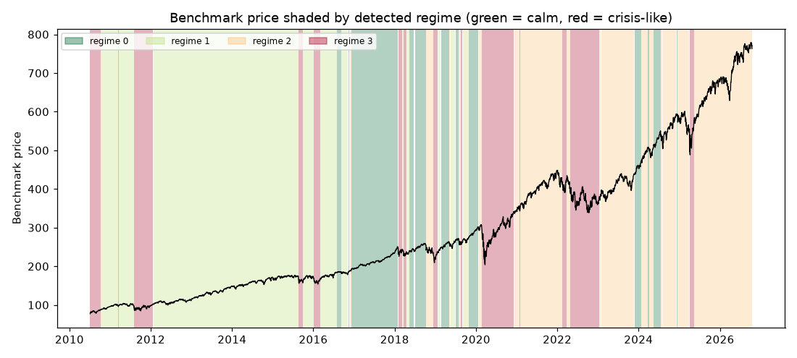

# Daily market regime research note — 2026-10-19

**Current regime: 2 (elevated) -- annualized vol 14.0%, Sharpe 0.74, historically 30% of trading days.**

## Current regime

- Regime **2** of 4 (states are numbered 0 = calmest ... 3 = most turbulent)
- Model: Gaussian HMM (`hmmlearn`), state count chosen by BIC over candidates [2, 3, 4]
- Analyst narrative source: deterministic

## Regime comparison

regime 0 (calm): ann. return 25.4%, ann. vol 7.4%, Sharpe 3.43, max drawdown -2.9%, 16% of days; regime 1 (moderate): ann. return 16.9%, ann. vol 12.1%, Sharpe 1.40, max drawdown -9.7%, 35% of days; regime 2 (elevated): ann. return 10.3%, ann. vol 14.0%, Sharpe 0.74, max drawdown -24.4%, 30% of days; regime 3 (crisis-like): ann. return 13.2%, ann. vol 29.6%, Sharpe 0.45, max drawdown -30.9%, 19% of days

## Regime statistics

|   regime |   n_days | share_of_days   | ann_return   | ann_vol   |   sharpe | max_drawdown   |   skew |   kurtosis |   n_episodes |   avg_episode_days |
|---------:|---------:|:----------------|:-------------|:----------|---------:|:---------------|-------:|-----------:|-------------:|-------------------:|
|        0 |      652 | 15.9%           | 25.4%        | 7.4%      |     3.43 | -2.9%          |  -0.18 |       1.13 |           12 |            54.3333 |
|        1 |     1424 | 34.8%           | 16.9%        | 12.1%     |     1.4  | -9.7%          |  -0.28 |       1.08 |           13 |           109.538  |
|        2 |     1240 | 30.3%           | 10.3%        | 14.0%     |     0.74 | -24.4%         |  -0.41 |       0.88 |           19 |            65.2632 |
|        3 |      781 | 19.1%           | 13.2%        | 29.6%     |     0.45 | -30.9%         |  -0.2  |       5.24 |           15 |            52.0667 |

## Per-regime notes

- **Regime 0**: Calm regime: 12 distinct episodes historically, averaging 54 trading days each.
- **Regime 1**: Moderate regime: 13 distinct episodes historically, averaging 110 trading days each.
- **Regime 2**: Elevated regime: 19 distinct episodes historically, averaging 65 trading days each.
- **Regime 3**: Crisis-like regime: 15 distinct episodes historically, averaging 52 trading days each.

## Method cross-check

- HMM vs GMM label agreement: 64%
- HMM vs KMeans label agreement: 55%

## Historical event sanity check

- COVID crash onset (2020-02-19): nearest trading day 2020-02-19 was regime 2
- 2022 rate-hike selloff (2022-01-01): nearest trading day 2021-12-31 was regime 2

## Caveats

Regime separation by mean return is not statistically significant (ANOVA p=0.70); regimes here primarily separate volatility, correlation-breakdown and liquidity behavior, not average forward returns. Cross-method label agreement: HMM vs GMM 64%, HMM vs KMeans 55%.

## Outlook

This note describes historical and current statistical regime characteristics only. It is not investment advice and does not predict future returns.

---

*Generated automatically by the regime-detection-agent pipeline on 2026-10-20 00:53 UTC. Universe: SPY + XLY, XLP, XLE, XLF, XLV, XLI, XLB, XLK, XLU. This note is end-of-day, backward-looking, and not investment advice.*