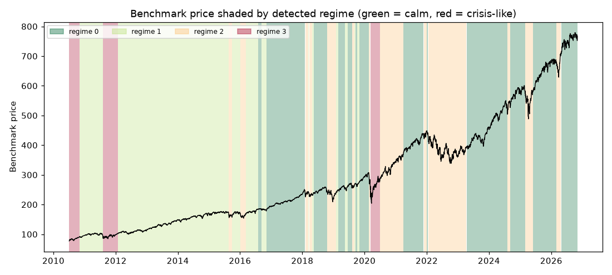

# Daily market regime research note — 2026-11-05

**Current regime: 0 (calm) -- annualized vol 10.6%, Sharpe 1.86, historically 38% of trading days.**

## Current regime

- Regime **0** of 4 (states are numbered 0 = calmest ... 3 = most turbulent)
- Model: Gaussian HMM (`hmmlearn`), state count chosen by BIC over candidates [2, 3, 4]
- Analyst narrative source: deterministic

## Regime comparison

regime 0 (calm): ann. return 19.7%, ann. vol 10.6%, Sharpe 1.86, max drawdown -10.0%, 38% of days; regime 1 (moderate): ann. return 16.0%, ann. vol 12.1%, Sharpe 1.32, max drawdown -9.7%, 34% of days; regime 2 (elevated): ann. return 1.1%, ann. vol 22.9%, Sharpe 0.05, max drawdown -24.0%, 21% of days; regime 3 (crisis-like): ann. return 34.2%, ann. vol 34.6%, Sharpe 0.99, max drawdown -25.0%, 7% of days

## Regime statistics

|   regime |   n_days | share_of_days   | ann_return   | ann_vol   |   sharpe | max_drawdown   |   skew |   kurtosis |   n_episodes |   avg_episode_days |
|---------:|---------:|:----------------|:-------------|:----------|---------:|:---------------|-------:|-----------:|-------------:|-------------------:|
|        0 |     1573 | 38.3%           | 19.7%        | 10.6%     |     1.86 | -10.0%         |  -0.49 |       1.86 |           13 |           121      |
|        1 |     1383 | 33.6%           | 16.0%        | 12.1%     |     1.32 | -9.7%          |  -0.27 |       1.05 |           11 |           125.727  |
|        2 |      868 | 21.1%           | 1.1%         | 22.9%     |     0.05 | -24.0%         |   0.13 |       3.95 |           14 |            62      |
|        3 |      286 | 7.0%            | 34.2%        | 34.6%     |     0.99 | -25.0%         |  -0.56 |       5.53 |            3 |            95.3333 |

## Per-regime notes

- **Regime 0**: Calm regime: 13 distinct episodes historically, averaging 121 trading days each.
- **Regime 1**: Moderate regime: 11 distinct episodes historically, averaging 126 trading days each.
- **Regime 2**: Elevated regime: 14 distinct episodes historically, averaging 62 trading days each.
- **Regime 3**: Crisis-like regime: 3 distinct episodes historically, averaging 95 trading days each.

## Method cross-check

- HMM vs GMM label agreement: 97%
- HMM vs KMeans label agreement: 88%

## Historical event sanity check

- COVID crash onset (2020-02-19): nearest trading day 2020-02-19 was regime 0
- 2022 rate-hike selloff (2022-01-01): nearest trading day 2021-12-31 was regime 0

## Caveats

Regime separation by mean return is not statistically significant (ANOVA p=0.23); regimes here primarily separate volatility, correlation-breakdown and liquidity behavior, not average forward returns. Cross-method label agreement: HMM vs GMM 97%, HMM vs KMeans 88%.

## Outlook

This note describes historical and current statistical regime characteristics only. It is not investment advice and does not predict future returns.

---

*Generated automatically by the regime-detection-agent pipeline on 2026-11-06 01:57 UTC. Universe: SPY + XLY, XLP, XLE, XLF, XLV, XLI, XLB, XLK, XLU. This note is end-of-day, backward-looking, and not investment advice.*