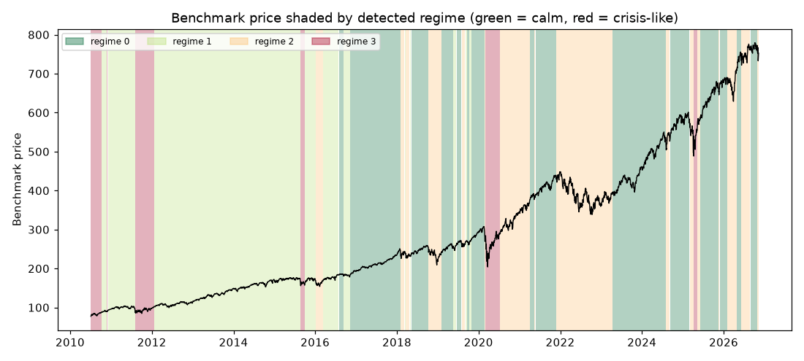

# Daily market regime research note — 2026-11-09

**Current regime: 2 (elevated) -- annualized vol 21.0%, Sharpe -0.04, historically 23% of trading days.**

## Current regime

- Regime **2** of 4 (states are numbered 0 = calmest ... 3 = most turbulent)
- Model: Gaussian HMM (`hmmlearn`), state count chosen by BIC over candidates [2, 3, 4]
- Analyst narrative source: deterministic

## Regime comparison

regime 0 (calm): ann. return 22.5%, ann. vol 9.9%, Sharpe 2.26, max drawdown -10.0%, 36% of days; regime 1 (moderate): ann. return 15.0%, ann. vol 12.1%, Sharpe 1.24, max drawdown -9.8%, 33% of days; regime 2 (elevated): ann. return -0.9%, ann. vol 21.0%, Sharpe -0.04, max drawdown -28.5%, 23% of days; regime 3 (crisis-like): ann. return 32.2%, ann. vol 35.6%, Sharpe 0.90, max drawdown -29.5%, 8% of days

## Regime statistics

|   regime |   n_days | share_of_days   | ann_return   | ann_vol   |   sharpe | max_drawdown   |   skew |   kurtosis |   n_episodes |   avg_episode_days |
|---------:|---------:|:----------------|:-------------|:----------|---------:|:---------------|-------:|-----------:|-------------:|-------------------:|
|        0 |     1474 | 35.8%           | 22.5%        | 9.9%      |     2.26 | -10.0%         |  -0.42 |       1.53 |           15 |            98.2667 |
|        1 |     1367 | 33.2%           | 15.0%        | 12.1%     |     1.24 | -9.8%          |  -0.28 |       1.09 |           11 |           124.273  |
|        2 |      938 | 22.8%           | -0.9%        | 21.0%     |    -0.04 | -28.5%         |  -0.33 |       1.25 |           16 |            58.625  |
|        3 |      334 | 8.1%            | 32.2%        | 35.6%     |     0.9  | -29.5%         |  -0.2  |       5.21 |            6 |            55.6667 |

## Per-regime notes

- **Regime 0**: Calm regime: 15 distinct episodes historically, averaging 98 trading days each.
- **Regime 1**: Moderate regime: 11 distinct episodes historically, averaging 124 trading days each.
- **Regime 2**: Elevated regime: 16 distinct episodes historically, averaging 59 trading days each.
- **Regime 3**: Crisis-like regime: 6 distinct episodes historically, averaging 56 trading days each.

## Method cross-check

- HMM vs GMM label agreement: 97%
- HMM vs KMeans label agreement: 87%

## Historical event sanity check

- COVID crash onset (2020-02-19): nearest trading day 2020-02-19 was regime 0
- 2022 rate-hike selloff (2022-01-01): nearest trading day 2021-12-31 was regime 2

## Caveats

Regime separation by mean return is not statistically significant (ANOVA p=0.12); regimes here primarily separate volatility, correlation-breakdown and liquidity behavior, not average forward returns. Cross-method label agreement: HMM vs GMM 97%, HMM vs KMeans 87%.

## Outlook

This note describes historical and current statistical regime characteristics only. It is not investment advice and does not predict future returns.

---

*Generated automatically by the regime-detection-agent pipeline on 2026-11-10 03:56 UTC. Universe: SPY + XLY, XLP, XLE, XLF, XLV, XLI, XLB, XLK, XLU. This note is end-of-day, backward-looking, and not investment advice.*