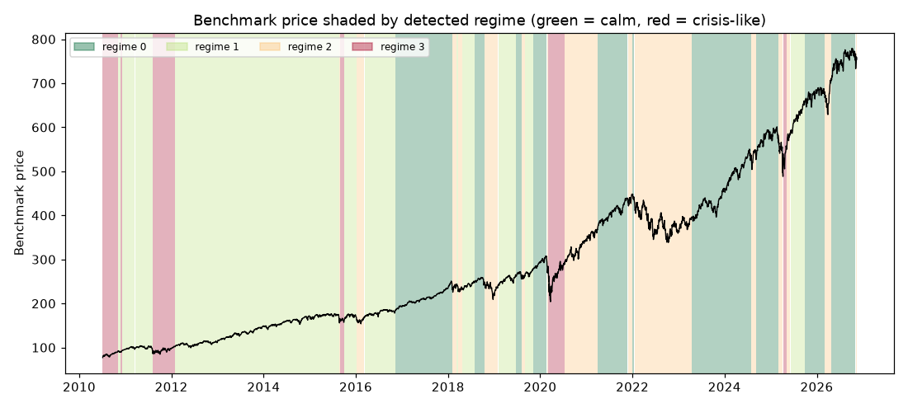

# Daily market regime research note — 2026-11-13

**Current regime: 2 (elevated) -- annualized vol 21.9%, Sharpe 0.06, historically 20% of trading days.**

## Current regime

- Regime **2** of 4 (states are numbered 0 = calmest ... 3 = most turbulent)
- Model: Gaussian HMM (`hmmlearn`), state count chosen by BIC over candidates [2, 3, 4]
- Analyst narrative source: deterministic

## Regime comparison

regime 0 (calm): ann. return 19.4%, ann. vol 10.8%, Sharpe 1.80, max drawdown -10.0%, 32% of days; regime 1 (moderate): ann. return 16.1%, ann. vol 11.7%, Sharpe 1.38, max drawdown -9.7%, 39% of days; regime 2 (elevated): ann. return 1.2%, ann. vol 21.9%, Sharpe 0.06, max drawdown -24.0%, 20% of days; regime 3 (crisis-like): ann. return 30.7%, ann. vol 34.1%, Sharpe 0.90, max drawdown -30.8%, 9% of days

## Regime statistics

|   regime |   n_days | share_of_days   | ann_return   | ann_vol   |   sharpe | max_drawdown   |   skew |   kurtosis |   n_episodes |   avg_episode_days |
|---------:|---------:|:----------------|:-------------|:----------|---------:|:---------------|-------:|-----------:|-------------:|-------------------:|
|        0 |     1329 | 32.3%           | 19.4%        | 10.8%     |     1.8  | -10.0%         |  -0.47 |       1.83 |           10 |           132.9    |
|        1 |     1609 | 39.1%           | 16.1%        | 11.7%     |     1.38 | -9.7%          |  -0.31 |       1.19 |           11 |           146.273  |
|        2 |      829 | 20.1%           | 1.2%         | 21.9%     |     0.06 | -24.0%         |  -0.29 |       1.23 |           15 |            55.2667 |
|        3 |      350 | 8.5%            | 30.7%        | 34.1%     |     0.9  | -30.8%         |  -0.22 |       6.1  |            7 |            50      |

## Per-regime notes

- **Regime 0**: Calm regime: 10 distinct episodes historically, averaging 133 trading days each.
- **Regime 1**: Moderate regime: 11 distinct episodes historically, averaging 146 trading days each.
- **Regime 2**: Elevated regime: 15 distinct episodes historically, averaging 55 trading days each.
- **Regime 3**: Crisis-like regime: 7 distinct episodes historically, averaging 50 trading days each.

## Method cross-check

- HMM vs GMM label agreement: 89%
- HMM vs KMeans label agreement: 81%

## Historical event sanity check

- COVID crash onset (2020-02-19): nearest trading day 2020-02-19 was regime 0
- 2022 rate-hike selloff (2022-01-01): nearest trading day 2021-12-31 was regime 0

## Caveats

Regime separation by mean return is not statistically significant (ANOVA p=0.29); regimes here primarily separate volatility, correlation-breakdown and liquidity behavior, not average forward returns. Cross-method label agreement: HMM vs GMM 89%, HMM vs KMeans 81%.

## Outlook

This note describes historical and current statistical regime characteristics only. It is not investment advice and does not predict future returns.

---

*Generated automatically by the regime-detection-agent pipeline on 2026-11-14 01:56 UTC. Universe: SPY + XLY, XLP, XLE, XLF, XLV, XLI, XLB, XLK, XLU. This note is end-of-day, backward-looking, and not investment advice.*