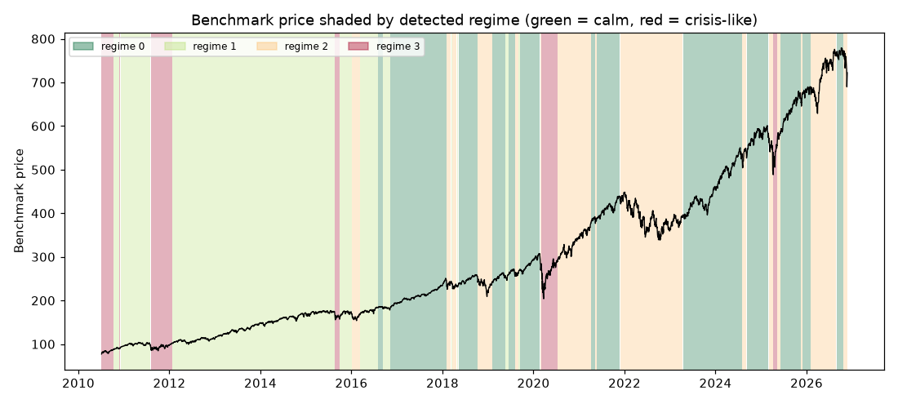

# Daily market regime research note — 2026-11-23

**Current regime: 2 (elevated) -- annualized vol 20.9%, Sharpe -0.02, historically 24% of trading days.**

## Current regime

- Regime **2** of 4 (states are numbered 0 = calmest ... 3 = most turbulent)
- Model: Gaussian HMM (`hmmlearn`), state count chosen by BIC over candidates [2, 3, 4]
- Analyst narrative source: deterministic

## Regime comparison

regime 0 (calm): ann. return 22.5%, ann. vol 10.0%, Sharpe 2.25, max drawdown -10.0%, 35% of days; regime 1 (moderate): ann. return 14.4%, ann. vol 12.1%, Sharpe 1.19, max drawdown -9.8%, 33% of days; regime 2 (elevated): ann. return -0.4%, ann. vol 20.9%, Sharpe -0.02, max drawdown -28.7%, 24% of days; regime 3 (crisis-like): ann. return 31.4%, ann. vol 35.5%, Sharpe 0.88, max drawdown -29.5%, 8% of days

## Regime statistics

|   regime |   n_days | share_of_days   | ann_return   | ann_vol   |   sharpe | max_drawdown   |   skew |   kurtosis |   n_episodes |   avg_episode_days |
|---------:|---------:|:----------------|:-------------|:----------|---------:|:---------------|-------:|-----------:|-------------:|-------------------:|
|        0 |     1458 | 35.4%           | 22.5%        | 10.0%     |     2.25 | -10.0%         |  -0.46 |       1.84 |           13 |           112.154  |
|        1 |     1352 | 32.8%           | 14.4%        | 12.1%     |     1.19 | -9.8%          |  -0.27 |       1.07 |           10 |           135.2    |
|        2 |      978 | 23.7%           | -0.4%        | 20.9%     |    -0.02 | -28.7%         |  -0.3  |       1.4  |           15 |            65.2    |
|        3 |      335 | 8.1%            | 31.4%        | 35.5%     |     0.88 | -29.5%         |  -0.2  |       5.22 |            6 |            55.8333 |

## Per-regime notes

- **Regime 0**: Calm regime: 13 distinct episodes historically, averaging 112 trading days each.
- **Regime 1**: Moderate regime: 10 distinct episodes historically, averaging 135 trading days each.
- **Regime 2**: Elevated regime: 15 distinct episodes historically, averaging 65 trading days each.
- **Regime 3**: Crisis-like regime: 6 distinct episodes historically, averaging 56 trading days each.

## Method cross-check

- HMM vs GMM label agreement: 95%
- HMM vs KMeans label agreement: 86%

## Historical event sanity check

- COVID crash onset (2020-02-19): nearest trading day 2020-02-19 was regime 0
- 2022 rate-hike selloff (2022-01-01): nearest trading day 2021-12-31 was regime 2

## Caveats

Regime separation by mean return is not statistically significant (ANOVA p=0.14); regimes here primarily separate volatility, correlation-breakdown and liquidity behavior, not average forward returns. Cross-method label agreement: HMM vs GMM 95%, HMM vs KMeans 86%.

## Outlook

This note describes historical and current statistical regime characteristics only. It is not investment advice and does not predict future returns.

---

*Generated automatically by the regime-detection-agent pipeline on 2026-11-24 05:43 UTC. Universe: SPY + XLY, XLP, XLE, XLF, XLV, XLI, XLB, XLK, XLU. This note is end-of-day, backward-looking, and not investment advice.*